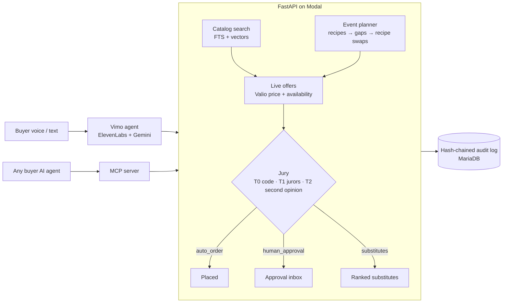

# Trusted Trade Agents · Vimo

**Junction 2026 · Valio Aimo challenge · Team Hello World**

An open ordering interface that Valio Aimo owns and that any buyer's AI agent can use. A kitchen talks to **Vimo**, its purchasing agent. Every order is priced live against the Valio Aimo APIs and judged by a **jury**: hard rules in code first, then AI jurors, then a human when it matters. It is then auto-placed, held for approval, or answered with substitutes. Every step lands in a **hash-chained audit log**.

> AI may propose and explain. Code enforces the rules. A human decides anything risky.

## Try it (3 minutes)

**Live:** **https://vimo-aimo.vercel.app** (the demo passphrase is in our submission). Use Chrome and allow the microphone.

1. Open **[/vimo](https://vimo-aimo.vercel.app/vimo/index.html)** and select **Talk to Vimo**, or type in the box.
2. **Single order:** *"Vimo, order 20 litres of lactose-free milk for Monday."*
   Vimo finds candidates in the 17,546-product catalog and prices them live. The jury picks the best compliant one, and it is placed, or held for you if it's over your auto-approve limit.
3. **Last-minute event:** *"Vimo, unexpected booking: 40 guests on Monday, creamy salmon soup and panna cotta."*
   Vimo breaks the dishes into ingredients and checks each one against live availability and order cut-offs. It flags what can't arrive in time and proposes **recipe-level substitutes** with adjusted amounts and a cooking note (e.g. *salmon → rainbow trout, shorten cooking by a minute*). A plain SKU swap would only change the product.
4. *"Order everything."* Every line is ordered and re-checked by the jury, 3 at a time. Held items can be approved by voice or in the popup.
5. Open **[/approvals](https://vimo-aimo.vercel.app/approvals)** for the human inbox with every juror's verdict, and **[/timeline](https://vimo-aimo.vercel.app/timeline)** for the tamper-evident audit trail.

Note: Valio Aimo delivers nothing before Monday 2026-11-16, so pick Monday or later. Earlier dates are correctly reported as unsourceable.

## What makes it trustworthy

| Problem with letting AI buy | What we do |
| --- | --- |
| A model hallucinates an allergen-safe product | **Tier 0 gates in code** (`app/jury/gates.py`): banned GS1 allergens, required claims, budget, sales block, delivery date and order cut-off. No model can override them. |
| Fuzzy questions ("is this really *milk*?") | **Tier 1 jurors** (spec, delivery, cost, plus an advisory sustainability juror) on a calibrated decision model. When confidence is low, a **Tier 2** small LLM gives a second opinion, and then a **human** decides. |
| "Trust me, it was ordered" | Every request, verdict, decision and approval is appended to a **SHA-256 hash chain** in MariaDB system-versioned tables. `GET /audit/verify` detects any edit or deletion. |
| Agents that do things nobody asked for | **Buyer policy** with auto-approve limit, budget, required claims, banned allergens and whether substitutes are allowed. Unknown claims are rejected when saved. |
| Pack-size maths errors | Quantities come from Valio's own units and comparison prices, e.g. 1,000 L of Valio Eila = **50 cases, €1,565.50**, not 51. |
| Duplicate or runaway orders | A duplicate guard per buyer, product, quantity and date, which holds under concurrent requests. |

**Jury benchmark** (20 hand-labelled substitution and anomaly cases, [`docs/t8_benchmark_results.md`](docs/t8_benchmark_results.md)): 100% gold agreement and **0 unsafe approvals out of 6 safety-critical cases** across all models, because the safety rules live in Tier 0 code. The calibrated decision juror costs about $0.02–0.025 per 1,000 evaluations.

## How it works



- **Catalog** (`app/catalog`): 17,546 products loaded into SQLite with full-text search over Finnish, English and Swedish names, blended with Gemini embeddings. Products are ranked by pack fit for the requested quantity.
- **Live offers** (`app/catalog/offers.py`): Valio `/api/price` and `/api/availability` for the shortlist only, with batching, a cache and retries. Stock evidence is *verified* (Stock), *estimated* (supplier-shipped) or *none*.
- **Jury** (`app/jury`): deterministic gates, then jurors, then escalation. Substitutes are re-screened through the same jury.
- **Event planning** (`app/planning`): recipe gaps, then live sourcing per ingredient, then recipe-level substitution rules (`substitutions.py`) under the buyer's policy.
- **Orders and audit** (`app/orders`): order state machine, human approve and reject, and the hash-chained audit log with verification.
- **Vimo** (`web/public/vimo`, `agent_configs/vimo-live.json`): the voice agent with client tools. It may only propose; the backend decides and records.
- **MCP server** (`mcp_server`): `search_products`, `get_offers`, `place_order`, `get_order_status` and `list_substitutes` for any external purchasing agent.
- **Web** (`web`): Next.js workspace (approvals inbox, jury, sourcing, timeline) and a pitch game, *Milk Run*, at `/game`.

**Stack:** Python 3.12, FastAPI, pydantic v2, MCP Python SDK, SQLite catalog, MariaDB Cloud (audit and orders), Gemini (decision juror, embeddings, Flash Lite), ElevenLabs Conversational AI, Next.js on Vercel, Modal, and GitHub Actions (tests, CycloneDX SBOM, deploy).

## Run it locally

```bash
brew install uv python@3.12
cp .env.example .env                  # VALIO_API_KEY (+ GEMINI_API_KEY for AI jurors and vector search); blank DB_URL for in-memory, or start MariaDB below
uv sync
uv run scripts/download_data.py       # products, schema, delivery reliability, carbon CSVs -> data/
uv run python -m app.catalog.loader   # -> data/catalog.db (~1 s, 17,546 products)
uv run uvicorn app.main:app --reload  # http://localhost:8000/docs · cockpit at http://localhost:8000/vimo/
uv run pytest -q                      # 300+ tests
uv run python scripts/demo_runner.py  # end-to-end: NL request -> MCP tools -> auto-order, stock-out, over-budget approval, audit verify
```

With `DB_URL` blank the orders and audit log live in memory; with the `.env.example` value, start the local MariaDB first: `docker compose -f db/docker-compose.yml up -d`.

## Repository map

```
contracts/      shared pydantic models (Mandate, Need, Offer, Verdict, Order, AuditEvent, EventPlan…)
app/catalog/    loader, search, Valio Aimo client, offer builder
app/jury/       Tier 0 gates, jurors, substitutes, benchmark harness
app/planning/   recipe gaps, event plan, recipe substitutions, standing-order drift
app/orders/     order service, need-based flow, policies, hash-chained audit log
app/experience/ Vimo backend: policies, order drafts, voice session
mcp_server/     MCP tools over the REST API · agent/  reference buyer agent
web/            Next.js UI · web/public/vimo  Vimo cockpit · web/public/game  pitch game
agent_configs/  tracked ElevenLabs agent config · scripts/  data, demo, benchmark, publishing
```

---

## For developers

### Demo passphrase gate
When `DEMO_PASSPHRASE` is set (Modal secret `aimo-api`, or your local `.env`), every API call needs either the `aimo_demo` cookie (`POST /auth/unlock {passphrase}`, the web `/unlock` page) or the header `X-Demo-Pass`. The exceptions are `/health`, `/auth/*` and the static `/game` and `/vimo` pages. When it is unset the gate is off (CI, tests). Never commit the passphrase. To revoke sessions, change `DEMO_PASSPHRASE` or `DEMO_SESSION_SECRET`.

### Vimo live-agent configuration
`agent_configs/vimo-live.json` is the reviewed source for the ElevenLabs agent's prompt, client tools and turn settings. Publishing replaces the live prompt and attaches exactly the tracked tools: existing ones are updated in place by name and new ones are created. Copy any dashboard-only edits into the file first. The dry run lists each tool as keep, update or create. Both commands need `ELEVENLABS_API_KEY`.

```bash
uv run python scripts/publish_vimo_agent.py          # dry run
uv run python scripts/publish_vimo_agent.py --apply
```

### MCP server
With the API running, run `uv run python -m mcp_server.server`. It uses stdio and works with MCP Inspector or Claude Desktop. Set `AIMO_API_URL` if the API is not at `http://127.0.0.1:8000`.

### Vector search
`/catalog/search` blends Gemini embeddings with full-text search when embeddings exist and `GEMINI_API_KEY` is set; otherwise it is text-only. Build or refresh with `uv run python -m app.catalog.embed`, which is resumable and incremental. Cached queries take under 200 ms. A new query costs one Gemini call and falls back to text-only after `SEARCH_EMBED_TIMEOUT_S`.

### Approval inbox (local)
```bash
uv run scripts/seed_demo.py    # placed / pending_approval / rejected demo orders
cd web && cp .env.example .env.local && npm install && npm run dev   # http://localhost:3000/approvals
```

### Pitch game "Milk Run"
https://vimo-aimo.vercel.app/game (live API). Offline: `cd web/public && python3 -m http.server`, then open `/game/`. Rehearsal parameters: `?autostart=1`, `?reveal=1&beat=N`, `?end=1`, `?shop=north|mega|corner|harbour`. Regenerate audio with `uv run scripts/gen_game_audio.py`.

### Deploy
- **API (Modal):** create the secret `aimo-api` (`VALIO_API_KEY`, `DB_URL`, `CORS_ORIGINS`, `GEMINI_API_KEY`, `DEMO_PASSPHRASE`, `ELEVENLABS_API_KEY`, `ELEVENLABS_VOICE_ID`), then run `uv run modal run modal_app.py::build_catalog` and `uv run modal deploy modal_app.py`. Pushes to `main` deploy automatically through `.github/workflows/deploy.yml`. After changing the secret, run `uv run modal app stop aimo-trusted-trade -y` and then deploy again.
- **Database:** MariaDB Cloud, with an app user without `DELETE HISTORY` or `DROP` (`db/migrations/000_init.sql`).
- **UI (Vercel):** root directory `web`, env `NEXT_PUBLIC_API_URL=<Modal URL>`. Manual production deploy from an up-to-date `main`: `cd web && npx vercel deploy --prod --yes`.
- **Live:** UI https://vimo-aimo.vercel.app · API https://weirdlyviral--aimo-trusted-trade-api.us-east.modal.run

### Workflow
One feature branch per change (`<lane>/<ticket>-<slug>`), a PR to `main`, and an adversarial code review before every PR. The full rules are in `CLAUDE.md`.
